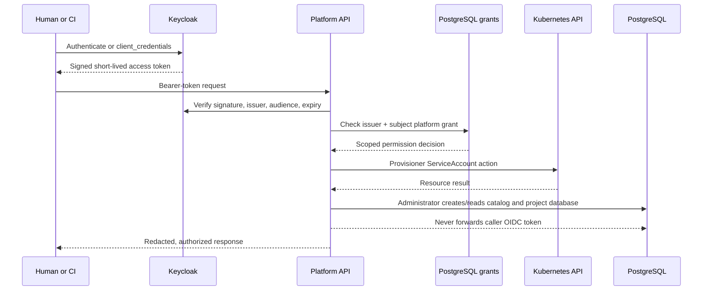
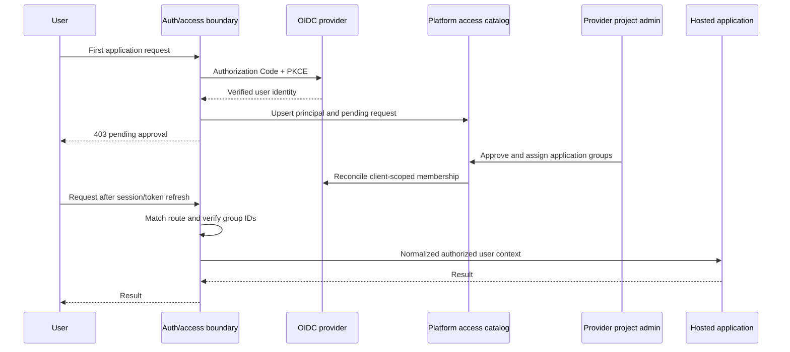
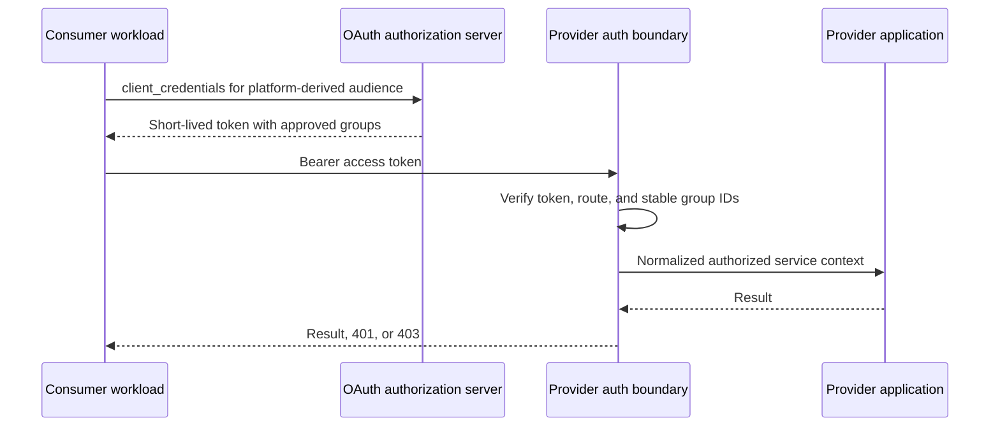
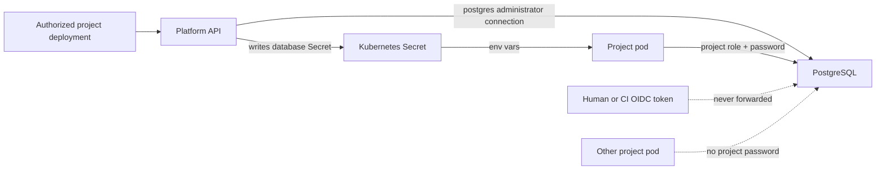
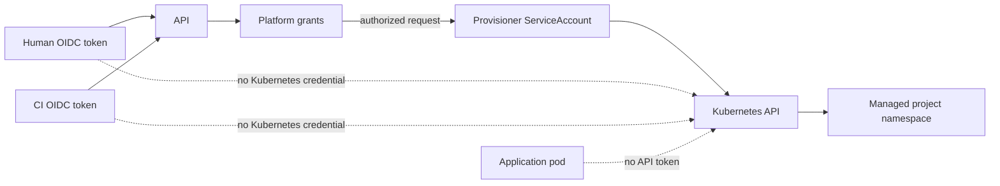

# Security and authorization

Status: current consolidated security and authorization model. Keycloak
authenticates callers; the Platform API owns platform grants and
hosted-application group lifecycle; the application access boundary enforces
group-protected public routes; and the API alone holds Kubernetes infrastructure
authority. Historical design material was consolidated from the earlier
security and authorization-principles pages.

## The four control-plane layers

1. **Keycloak authentication** proves the issuer and immutable subject of a
   human or machine caller with a short-lived OIDC access token.
2. **Platform authorization** maps that issuer/subject pair to platform-owned
   project or platform grants stored in PostgreSQL.
3. **Kubernetes execution** occurs only through the Platform API's provisioner
   ServiceAccount after a platform permission check succeeds.
4. **PostgreSQL authorization** is a separate database connection and privilege
   decision. The API creates the project login/database and a workload connects
   using that login; Keycloak tokens are never presented to PostgreSQL.

Keycloak roles and a valid JWT do not by themselves grant access to a project or
to Kubernetes. Project users, CI clients, and application pods do not receive a
kubeconfig or the provisioner token.



## Keycloak identities

Humans normally use Authorization Code with PKCE through the browser portal or a
supported OIDC flow for CLI/API access. The API validates JWT signature through
the issuer JWKS, configured issuer, `platform-api` audience, expiry, and stable
subject.

CI uses a separate confidential Keycloak client generated for a deployment
credential or test identity. It obtains tokens with `client_credentials`. The
returned client secret is disclosed once; it is distinct from a person’s token
and from infrastructure credentials.

## Platform-owned grants

After authentication, the API uses the immutable `(issuer, subject)` pair to
look up project and platform grants in its catalog. Permissions distinguish
observation, change, deployment, project administration, and platform
administration. This permits immediate platform denial without waiting for JWT
expiry: removing a grant makes the next API request fail even if its Keycloak
token remains cryptographically valid.

Audit records attribute actions to the authenticated principal. Values of bearer
tokens, secrets, and database credentials are redacted.

## Hosted-application authentication and authorization

Hosted-application browser and confidential service clients are separate from
platform user and deployment credentials. An application owner binds protected
routes and methods on the public component to `browser-session` or
`bearer-token` and to allowed project-scoped application groups. The platform
derives and manages clients, redirect URIs, audiences, standard OIDC scopes,
sessions, group claims, and secrets. A platform role never grants an application
group implicitly.

The reference deployment has one identity realm per platform environment, with
separate clients and audiences per application or technical purpose. It does
not create a realm per application. Application-group definitions and
memberships are platform resources identified by opaque stable IDs; provider
display names are implementation attributes. In the Keycloak reference adapter,
each group is an application-resource-client role named with the stable group
ID, and a protocol mapper emits relevant roles in a client-scoped `groups`
claim. The platform limits each claim to memberships relevant to the target
application.

Each public application receives a platform-managed OAuth2 Proxy deployment or
configuration with its own browser client, callback, and cookie. Browser traffic
then reaches a shared replicated platform authorizer. Machine traffic skips the
browser-session proxy but reaches the same authorizer, which validates the
bearer token. The authorizer owns route matching, first-login recording,
revocation overrides, and normalized headers for both modes.

### Authentication modes

| Mode | Credential presented | Unauthenticated behavior | Principal |
| --- | --- | --- | --- |
| `browser-session` | Secure HTTP-only session cookie created after Authorization Code with PKCE | Redirect to login; an expired session is cleared and login restarts | `user` |
| `bearer-token` | Short-lived access token obtained by a confidential client | Return `401`; never redirect and never create a browser session | `service` for `client_credentials` |

Both modes produce the same normalized identity context. The platform access
boundary authorizes the matched route from the principal's stable application
group IDs before forwarding the request. Cookie-authenticated state changes
require platform-provided CSRF protection. Bearer-token calls do not use ambient
cookies and therefore do not use that CSRF mechanism.

### Hosted human identity flow

The identity provider, not the Developer Platform or hosted application, owns
the human account, password, MFA, account recovery, invitation, registration,
and federation lifecycle. Identity administrators create or federate accounts;
project administrators cannot create realm users.
The reference flow is:

1. An identity administrator creates the person in Keycloak, or the person is
   federated from an accepted external identity source. The provider assigns an
   immutable subject.
2. An application owner creates project-scoped application groups and binds an
   explicit route/method match on the public component to `browser-session` and
   one or more allowed group IDs. The platform creates the client and derives
   its callback from the platform-owned hostname and callback path.
3. OAuth2 Proxy completes Authorization Code with PKCE, validates the OIDC
   response, and creates a secure browser session. The platform access layer
   maps the verified issuer and subject to an opaque principal ID.
4. On first login, the access layer automatically creates or reuses one pending
   application-access request keyed by application, issuer, and subject, with no
   group. The request does not reach the application and receives a platform
   pending page or safe `403 application_access_pending` problem with request ID.
5. A provider project administrator reviews the request and assigns application
   groups through the platform control plane. Project administration permits
   this assignment but does not itself make the administrator an application
   user or application administrator.
6. The platform reconciles the membership to the identity provider. After the
   session or token is refreshed, the access boundary admits a request only when
   its stable group IDs satisfy the matched route policy.

OAuth2 Proxy is the reference browser implementation, not part of the public
platform contract. It can request the OIDC group scope, read a configured group
claim, and forward verified group values, but it does not provide the platform's
first-login request, approval lifecycle, revocation override, or complete
route-policy model. The shared authorizer supplies those functions and
normalizes provider claims. A compatible proxy or authorizer may replace this
composition while preserving the same public resources and security contract.

The platform keys a human by `(issuer, subject)` and supplies the resulting
principal ID to the application. Email, username, display name, and group display
names are mutable attributes and must not be used as unique authorization keys.
The platform-generated principal and group IDs are the opaque authorization keys
and always map back to the verified identity and platform-owned membership
records.



The backend accepting access-boundary headers must be private. Network policy
allows the edge to reach the boundary and the boundary to reach the backend,
but does not allow another project workload to reach that backend around the
boundary. This is required even though project components share a credential
boundary: an unsigned header is trustworthy only on the enforced
boundary-to-backend path.

### Hosted machine identity flow

An authorized consumer submits a service-access request referencing a target
application's `bearer-token` policy. A provider project administrator approves
the request and assigns target application groups before a usable credential is
issued. The platform derives the audience from the target's stable identifier,
creates the confidential service identity, reconciles the approved membership,
returns its secret once through the managed project-secret path, and records
only non-secret lifecycle metadata in ordinary state. The initial profile has no
application-defined OAuth scopes; the provider's coarse permission vocabulary
is expressed as project-scoped application groups.

The calling application uses `client_credentials` to obtain a short-lived
access token. The provider authentication boundary validates the token's
signature, issuer, access-token type, audience, expiry and other validity times,
subject, client identifier, and client-scoped group claim. It matches the route
and method and forwards the request only if at least one allowed stable group ID
is present. The Keycloak adapter assigns the application's client roles to the
service-account identity and maps them to the same client-scoped `groups` claim
used for humans.



The normalized application identity context is:

| Field | Meaning |
| --- | --- |
| `principal_id` | Opaque stable platform mapping for the verified principal |
| `principal_kind` | `user` or `service` |
| `issuer` | Exact trusted OIDC/OAuth issuer |
| `subject` | Immutable subject within that issuer |
| `client_id` | Validated OAuth client identifier, when applicable |
| `group_ids` | Stable IDs of relevant application groups asserted for this client |

### Upstream identity transport

The application does not inspect the browser session cookie, parse the bearer
token, or call Keycloak or the Platform API to discover the current caller. The
authentication boundary writes the verified context into reserved request
headers on every authenticated upstream request:

| Header | Required | Value |
| --- | --- | --- |
| `X-Platform-Principal-Id` | Yes | Opaque stable platform principal ID |
| `X-Platform-Principal-Kind` | Yes | `user` or `service` |
| `X-Platform-Principal-Issuer` | Yes | Exact verified issuer |
| `X-Platform-Principal-Subject` | Yes | Verified subject within the issuer |
| `X-Platform-Principal-Group-Ids` | Yes | Space-delimited stable group IDs relevant to this application/client; may be empty only before denial and is never forwarded to a protected application as an authorization success |
| `X-Platform-Principal-Client-Id` | For service principals | Verified confidential client ID |
| `X-Platform-Principal-Name` | No | Display-only human name when the access policy opts in |
| `X-Platform-Principal-Email` | No | Display-only human email when the access policy opts in and project classification covers personal data |

A browser-session request therefore reaches the application like:

```http
X-Platform-Principal-Id: prn_93fb6d66
X-Platform-Principal-Kind: user
X-Platform-Principal-Issuer: https://identity.example.org/realms/platform
X-Platform-Principal-Subject: 53ca4128-297c-4984-b855-4292329d75da
X-Platform-Principal-Group-Ids: grp_7ae814 grp_ee0912
```

A client-credentials request reaches it like:

```http
X-Platform-Principal-Id: prn_80a6ec21
X-Platform-Principal-Kind: service
X-Platform-Principal-Issuer: https://identity.example.org/realms/platform
X-Platform-Principal-Subject: service-account-8eb77d7a
X-Platform-Principal-Client-Id: consumer-project-client
X-Platform-Principal-Group-Ids: grp_5b92d1
```

Application middleware reads these headers once per request, rejects a missing
or malformed required context, and stores the resulting principal in the
framework's request-local security context. The route has already passed the
platform's group policy. `name`, `email`, and group display names are never
lookup or authorization keys. An application may use the stable principal and
group IDs for presentation or for finer object/row authorization, but it must
not repeat the platform's coarse route check. An application without finer
domain rules needs no application-specific authorization store. Missing optional
name or email attributes never cause authentication or authorization failure,
and they are excluded from telemetry and authorization audit details unless an
explicit requirement permits them.

The platform makes this unsigned upstream-header contract trustworthy by:

- deleting all inbound `X-Platform-Principal-*` headers before authentication;
- adding exactly one normalized value for each applicable header only after
  authentication and route authorization succeed;
- reserving the `X-Platform-*` header namespace for platform use;
- allowing the edge to reach the authentication boundary and the boundary to
  reach the private backend, while denying direct backend access;
- removing the bearer `Authorization` header before forwarding unless a future
  delegation capability explicitly requires it; and
- failing closed when authentication, group-policy evaluation, or
  identity-context construction is unavailable.

The current-caller context is request-scoped; the application does not retrieve
it through a directory API. First login is handled by the platform access layer,
which creates a pending request without a group and denies the application
request. Provider project administrators inspect and approve pending requests
through the platform control plane. The initial profile does not expose a
general human-directory search or pre-provisioning capability.

Missing or invalid authentication produces `401` or initiates browser login.
Valid authentication without a group allowed by the matched policy produces
`403`. Application code must not infer a business role from a platform role, a
successful login, an email address, or possession of a target-audience token.

A public component may assign different modes and allowed groups to exact paths
or segment-aware path prefixes with explicit methods, for example
`browser-session` on `/app/`, a separate administrator group on `/admin/`, and
`bearer-token` on `/machine-api/`. Query parameters do not participate; `HEAD`
follows `GET`; and `OPTIONS` is denied unless explicitly configured. Invalid
percent encoding, encoded slash or backslash, backslashes, and dot segments are
rejected. Every externally reachable application route matches exactly one
rule. Overlapping rules are rejected and unmatched routes are denied. Each rule
has a non-empty `anyOfGroups`; hierarchy, negation, `allOfGroups`, anonymous
routes, and general Boolean expressions are outside the initial profile. A
general `session-or-bearer` mode on the same route is also outside the initial
profile because it makes redirect behavior, CSRF enforcement, identity
precedence, and auditing ambiguous. The boundary strips the bearer token before
forwarding unless a future delegation capability explicitly requires it.

PostgreSQL owns desired membership state and Keycloak is a reconciled
projection. A grant remains non-authorizing in `provisioning` and becomes
`active` only after provider confirmation. Revocation immediately enters
`revocation-pending` and is removed from the authorizer's effective policy even
if a token or session still asserts the group. Provider cleanup retries until
`revoked`; failure never restores access.

Each replicated authorizer keeps a versioned policy/membership snapshot for no
more than five minutes and consumes prompt invalidations. During a control-plane
outage it may serve existing traffic only while authentication material and the
snapshot remain valid; an expired snapshot fails closed. This is the accepted
maximum authorization-staleness bound, and PLAN-009 must test it.

### Session, policy, and resource lifecycle

Machine access tokens last no more than five minutes and `client_credentials`
does not receive a refresh token. Browser authorization claims refresh at least
every five minutes; the secure application-specific session has a 30-minute idle
timeout and eight-hour absolute lifetime. The cookie is Secure, HTTP-only, and
SameSite-protected. Logout clears it and initiates provider logout when
supported. Restored browser sessions are always invalidated.

Groups, policies, human requests, memberships, service requests, and approvals
are first-class Platform API resources separate from deployment declarations.
They use stable generated IDs, resource-version/`If-Match` updates, idempotent
creates, durable provider operations, and audited transitions. A project
administrator manages these resources but receives no application group
implicitly. An application-administrator group grants application route access
only and never Platform API authority.

Pending first-login requests expire after 30 days. Expired requests may be
created again by a later login; rejected requests require explicit administrator
reopening. Terminal requests and revoked membership records are removed after
90 days, while minimized audit events follow the platform audit policy.

Access-policy updates create immutable revisions. A complete revision is
validated, compiled, loaded by every ready authorizer replica, and atomically
activated. A replica that cannot load it leaves readiness. Restrictive changes
deny first; permissive changes prepare dependencies and grant last. Each request
uses one complete revision, and the prior revision is retained for bounded
rollback.

Normal machine credential rotation creates a replacement client for the same
logical service principal and delivers a new managed-secret version. Both
clients may work for at most 24 hours while the consumer confirms adoption; the
old client is then revoked, or is automatically revoked with an
adoption-timeout condition when the window expires. The principal ID remains
stable and the client-ID header identifies the credential version. Emergency
rotation revokes the old client without overlap.

After recovery, the restored platform catalog reconciles outward to Keycloak;
Keycloak state is neither imported nor bidirectionally merged as authorization
truth. Protected routes stay unavailable until clients, roles, mappers,
memberships, and authorizer policy reconcile. Pending/rejected states survive,
active memberships are reprovisioned, and `revocation-pending` remains denied.
An inconsistently restored service credential is rotated and redelivered rather
than guessed or exposed.

The project is the first-release service-secret isolation boundary. The project
secret may be mounted into every service and scheduled component, so application
owners must not assume component-level credential isolation or attribution. A
machine token obtained with a shared project credential identifies the project
service client, not the particular component that used it. Secret values are
Restricted: they never belong in desired state, ordinary reads, logs, metrics,
audit details, explanations, or acceptance evidence.

Projects record a maximum data and telemetry classification separately from
their deployment declaration. Public classification does not make an initial
application route anonymous; Internal data remains authenticated; Confidential
application data receives project-scoped access and encrypted backup handling;
Restricted data is limited to managed secrets and credentials in the initial
profile. See
[ADR-020](decisions/ADR-020-generic-hosted-application-integration.md) for the
complete handling and retention decision.

## PostgreSQL authorization

PostgreSQL is outside k3d on the shared Docker network. It is not an OIDC
resource server in this implementation: it does not validate Keycloak JWTs and
does not know the human or CI principal that requested a deployment. Its native
authentication is the PostgreSQL role/password presented on a database
connection. The Platform API therefore must not treat a successful OIDC request
as authority to give the caller a database password or direct SQL access.

There are two distinct database authority paths:

| Path | Database identity | Current authority |
|---|---|---|
| Platform control plane | `postgres`, held by the Platform API | Creates the catalog tables and project roles/databases; reads/writes platform grants, desired state and audit records |
| Project workload | `project_<project-name>`, injected into that project's pods | Connects to its own project database and, because it owns that database, currently performs application SQL and schema migration |

When an authorized create/update request provisions project `orders`, the API
derives `project_orders` and a password from `DATABASE_KEY`, creates the login
only if absent with `NOSUPERUSER`, `NOCREATEDB`, and `NOCREATEROLE`, creates its
database with that role as owner if absent, and revokes `PUBLIC` access to that
database. It creates the Kubernetes `database` Secret with `PGHOST`, `PGPORT`,
`PGDATABASE`, `PGUSER`, and `PGPASSWORD`; the workload receives these values as
environment variables. The Secret is not returned by platform read APIs.



Kubernetes controls delivery of the Secret to the pod; PostgreSQL controls
whether the supplied role can connect and what it can do once connected. The
network policy complements both: project workloads may make TCP/5432 egress
only to the configured PostgreSQL IP, alongside same-namespace traffic and DNS.
It is a reachability control, not a substitute for SQL authorization.

### Current limits and lifecycle implications

The current per-project workload role owns its database, so it has broader
schema power than a future least-privilege runtime role would. A separate
read-only human role and restricted SSH forwarding path are implemented in
source; [human database access](../developers/database-access.md) describes the
grant and revocation model. Deployed isolation and session-revocation checks
remain Phase 10 work. A distinct migration/owner role is not implemented.
Project retirement retains the database and workload role, but disables human
database logins; permanent purge removes those human roles.

Passwords are deterministic while `DATABASE_KEY` remains unchanged. Changing
only that key and redeploying changes the Kubernetes Secret but does **not**
change an existing PostgreSQL role password; rotation must coordinate SQL, Secret
update, and workload reconnection. PostgreSQL transport encryption is not
configured in this single-host baseline. ADR-020 explicitly places
application-to-PostgreSQL traffic outside the initial cross-project
encrypted-channel requirement. Treat the database network and the Platform
API's administrator credential as trusted infrastructure, do not claim that all
application traffic is encrypted, and do not use this arrangement for hostile
multi-tenant workloads or general Restricted business data.

For the authoritative implementation limits and planned identity split, see
[ADR-013](decisions/ADR-013-database-credential-lifecycle.md) and
[ADR-003](decisions/ADR-003-postgresql-provisioning.md).

## Kubernetes authority

The Docker-hosted API uses the `platform-system/provisioner` ServiceAccount to
reconcile namespaces, secrets, quotas, limit ranges, deployments, CronJobs,
Services, Ingresses, NetworkPolicies, pod logs, and pod metrics. It is trusted
infrastructure, not a tenant identity.



RBAC grants namespace deletion because retirement needs it, but a
`ValidatingAdmissionPolicy` restricts that action to the provisioner identity
and managed labelled `project-*` namespaces. This compensates for RBAC’s lack
of name/label-scoped delete rules.

## Workload restrictions

Project pods have no automatically mounted Kubernetes API token. They run
non-root with a read-only root filesystem, dropped capabilities, RuntimeDefault
seccomp, and network policies. These controls reduce authority but do not make
the single shared Docker host suitable for hostile tenants.

## Revocation and rotation

The generic hosted-access reference implementation is now in
`platform/app/src/app/access_*`: PostgreSQL resources and durable operations,
Keycloak projection, per-policy OAuth2 Proxy, and the shared replicated request
boundary. See the [API guide](../developers/api.md#hosted-application-access)
for exact resource bodies and the
[installation/recovery runbook](../operators/identity-and-access.md#hosted-application-access-installation-and-recovery)
for operational safeguards. Deployed core evidence is recorded in
[EV-45](../maintainers/delivery/backlog.md#verification-register): human/machine
access, IPv4 backend/egress isolation, rotation, timed expiry and existing-session/
token revocation passed on node-01. This does not close PLAN-009/F-10; dependency
outage, restored access, long timers, retention and other deferred checks remain
open in the [dated run record](../operators/validation/access-and-authorization.md#executed-hosted-access-core-acceptance-october-11-2026).
The existing legacy single-service route is not migrated
implicitly; hosted protection requires `v1alpha2`.

The boundary handles browser callback/start/logout itself. A browser policy
includes a `GET` entry route; state-changing requests additionally require a
same-origin request and the readable platform CSRF cookie value in
`X-Platform-CSRF-Token`. The identity token and access token remain at the
boundary. Both authentication paths strip authorization and caller-supplied
identity headers before forwarding; application responses cannot overwrite
platform authentication cookies. Subject identity comes from OIDC `sub`, not
an email claim. Optional display name/email release remains separately governed.

The supported isolated restore workflow quarantines the restored access
catalog before starting application access. Explicit operator reconciliation
rotates uncertain machine credentials and browser session epochs before the
flag is cleared. Authorizers fail closed during this process and policies become
active only after provider preparation and ready-replica acknowledgement.

| Target | Immediate platform effect |
|---|---|
| Project/platform grant | Next request by the identity is denied |
| Deployment credential | Platform grant is removed before Keycloak client cleanup |
| Provisioner token | Delete `provisioner-token`, rerun bootstrap, restart API |
| Application secret | Versioned Secret rotation rolls workloads; confirm/revert controls old value removal |

See [platform application](platform-application.md), [Kubernetes infrastructure](../operators/infrastructure.md), and the [human authorization runbook](../operators/validation/access-and-authorization.md).
