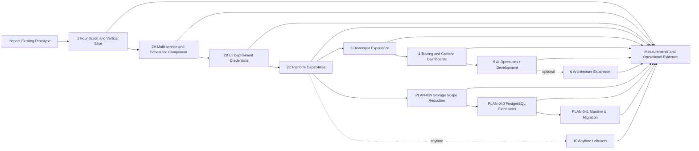

# Delivery status and plans

Status: current delivery index as of November 12, 2026. Future phases are
proposals without confirmed dates.

## Architectural evolution

- **Date:** September 19, 2026
  - **Milestone:** Self-service, capabilities, labs; Kubernetes with an external
    PostgreSQL service
  - **Significance:** Product scope and initial infrastructure boundaries
- **Date:** September 20, 2026
  - **Milestone:** Security assessments, monitoring outside the cluster, five-VM
    option, PHP/MySQL watchdog
  - **Significance:** Failure boundaries and operational requirements
- **Date:** September 21, 2026
  - **Milestone:** Hybrid topology selected for the existing single host
  - **Significance:** Revised starting topology; deployment not verified
- **Date:** September 21, 2026
  - **Milestone:** Automatic database secrets identified as existing behavior;
    separate human access proposed
  - **Significance:** Implementation baseline and next access-management
    extension
- **Date:** September 21, 2026
  - **Milestone:** MVP vertical slice defined; Python baseline established and
    Quarkus considered
  - **Significance:** Inspect the prototype before any rewrite
- **Date:** September 23, 2026
  - **Milestone:** Identity and role management for platform and hosted
    applications
  - **Significance:** Proposed IAM model
- **Date:** September 24, 2026
  - **Milestone:** UI/API deployment options and technology-independent Platform
    API
  - **Significance:** Shared contract and provider abstraction
- **Date:** September 24, 2026
  - **Milestone:** AI focus on operations/development; ApplicationSpec defined
  - **Significance:** Extensions above the same API
- **Date:** September 25, 2026
  - **Milestone:** Structured documentation established
  - **Significance:** Separate architecture, decisions, and planning
- **Date:** October 1, 2026
  - **Milestone:** Kotlin/Spring catalog, Quarkus control plane, and Python
    automation roles selected
  - **Significance:** Target ownership boundaries accepted; staged
    implementation and migration remain open
- **Date:** October 2, 2026
  - **Milestone:** Generic OIDC boundary accepted with Keycloak as the supported
    lab reference
  - **Significance:** Platform-owned project grants and Phase 1B roles selected,
    implemented, and accepted under the recorded owner-directed alert-delivery
    exception
- **Date:** October 4, 2026
  - **Milestone:** Multi-service application with a cron-triggered component
    prioritized
  - **Significance:** F-13 and UC-07 added; versioned contract, migration,
    internal discovery, scheduled-run status, and Kubernetes acceptance are the
    next Phase 2A increment
- **Date:** October 4, 2026
  - **Milestone:** Revocable CI deployment credentials prioritized after
    multi-service support
  - **Significance:** F-14, UC-08, and ADR-018 added; scoped OIDC machine
    credentials and immediate platform revocation form Phase 2B; former Phase 2B
    work moves to 2C
- **Date:** October 4, 2026
  - **Milestone:** Empty-project and machine-driven platform acceptance added to
    Phase 2B
  - **Significance:** F-15 and UC-09 add human-bootstrapped test-runner
    credentials, temporary role personas, and first deployment by CI after
    empty-project creation
- **Date:** October 4, 2026
  - **Milestone:** Current runtime architecture retained
  - **Significance:** Phase 2C remains on the existing Kubernetes infrastructure
    and single Python/FastAPI application; a Docker compute adapter and polyglot
    service split are optional future work (now Phase 6)
- **Date:** October 6, 2026
  - **Milestone:** React UI stack selected for the Phase 3 portal
  - **Significance:** React, TypeScript and Vite with typed OpenAPI access,
    TanStack Query, React Router, shadcn/Base UI, Tailwind, forms/validation,
    and browser/component tests replace the open Angular candidate
- **Date:** October 10, 2026
  - **Milestone:** Generic capabilities required by the energy-system use case
    made the Phase 3 priority slice
  - **Significance:** Application-owned declarations consume generic
    hosted-application OIDC, authenticated HTTPS egress, component monitoring,
    restart, and recovery; the platform contains no ODIP/VEF-specific profiles
    or behavior
- **Date:** October 14, 2026
  - **Milestone:** Tracing and dashboards inserted before AI operations
  - **Significance:** Phase 4 adds bounded tracing and provisioned operator
    Grafana dashboards; AI operations moves to Phase 5 and optional architecture
    expansion to Phase 6
- **Date:** October 15, 2026
  - **Milestone:** Phase 4 tracing design selected
  - **Significance:**
    [ADR-021](../../architecture/decisions/ADR-021-phase-4-tracing-boundary.md)
    fixes Tempo/Alloy, authenticated app export, opt-in contract, sampling,
    storage budget, and scoped trace reads; implementation remains open
- **Date:** October 15, 2026
  - **Milestone:** Remaining acceptance moved to an anytime phase
  - **Significance:** Former Phase 3A work became visible, unscheduled leftovers
    that do not gate Phases 3–5 or optional 6; this plan is now Phase 10
- **Date:** October 17, 2026
  - **Milestone:** Data store roadmap consolidated into Phases 7–8
  - **Significance:** Phase 7 groups planned store packages and Phase 8 groups
    deferred packages; measurement and comparison were later separated
- **Date:** October 18, 2026
  - **Milestone:** Store measurement separated from provider acceptance
  - **Significance:** Phase 9 owns dashboards and comparisons; former Phase 9
    anytime leftovers become Phase 10, still last and lowest priority
- **Date:** November 12, 2026
  - **Milestone:** PostgreSQL and S3 project data-store scope selected
  - **Significance:**
    [ADR-022](../../architecture/decisions/ADR-022-postgresql-and-s3-storage-scope.md)
    supersedes non-retained store expansion; PLAN-039 owns migration, removal,
    capacity verification, and the separate storage lab; PLAN-040 adds
    TimescaleDB, PostGIS, pgmq, and pg_duckdb afterward
- **Date:** November 12, 2026
  - **Milestone:** Mantine portal migration planned after PostgreSQL extensions
  - **Significance:**
    [ADR-023](../../architecture/decisions/ADR-023-mantine-portal-components.md)
    changes the future component and styling choice; PLAN-041 follows PLAN-040
    while preserving the portal's API, auth, and feature behavior

## Implementation status

The [delivery backlog](backlog.md#evidence-conventions) is the source of truth
for task status, implementation findings and acceptance evidence. Its imported
September 26 baseline records a partial administrator-operated foundation. Phase
1A is complete under the accepted limitations in ADR-011, ADR-016, and ADR-017;
Phase 1B is complete under its recorded owner-directed alert-delivery exception;
Phase 1C is complete under the limits recorded in its October 3 gate audit.
Phase 2A passed its deployed acceptance suite on October 4 under its recorded
owner-accepted deferrals for database-row preservation, backup inventory, and
representative capacity measurement. Phase 2B is accepted under its recorded
deferrals for expiry, controlled identity-provider outage, and deployed backup
coverage. Phase 2C is complete with the protected live-drill evidence and
accepted single-lab limits recorded in the backlog. Phase 3 is complete under
the owner-directed source/local scope and named deployed-acceptance exception in
its
[completion record](history/phase-3-developer-experience.md#completion-record-october-15-2026).
[Phase 10 anytime leftovers](plans/phase-10-anytime-leftovers.md) collects
unfinished contract, identity, monitoring, integration, recovery, portal,
template, and human-database acceptance; it is listed last and may be done
whenever capacity allows. Concrete energy-system declarations and domain
assertions remain externally owned. The current delivery architecture remains
the existing Kubernetes provider and one Python/FastAPI API application. Consult
task notes and the verification register for revisions, environments and limits.

Current store evidence as of October 18 includes PostgreSQL's scoped
deterministic 7.1 exit (EV-67), native provider/extension checks (EV-68/69), a
synthetic artifact/outbox/search flow (EV-71), and real native console journeys
(EV-72). Seven EV-71/72 purges remain awaiting a verified scheduled backup; this
review adds no deletion, restore or elapsed-time acceptance. Details remain in
the [verification register](backlog.md#verification-register).

## Work sequence and gates

**PLAN-020**, the
[hosted-application access UI](plans/ui.md#4a-deliver-hosted-application-access-plan-020),
is accepted for lab sequencing under an
[owner-directed exception](backlog.md#additional-phase-tasks). The deployed
screens and active policy were observed; the deployed approval, service-access,
denial, and audit journeys were waived and remain unverified. Identity,
monitoring, integration, and recovery acceptance remain open.

- **Phase:** [1](history/phase-1-foundation.md)
  - **Entry condition:** Access to actual code and target host
  - **Outcome / dependency:** 1A operational protection, 1B accountable
    access/security alerts, 1C durable lifecycle and minimal API/CLI, with
    internal ownership seams in the Python application
- **Phase:** [2A](history/phase-2a-multi-service-scheduled-application.md)
  - **Entry condition:** Accepted Phase 1 vertical slice
  - **Outcome / dependency:** Versioned multi-service contract; internal
    discovery; independently observable long-running services and cron-triggered
    component on Kubernetes; lossless single-component migration
- **Phase:** [2B](history/phase-2b-ci-deployment-credentials.md)
  - **Entry condition:** IAM boundary and accepted Phase 2A gate
  - **Outcome / dependency:** Empty-project bootstrap; scoped deployment
    credentials; human-created test runner and temporary role personas;
    machine-driven deploy/observe and authorization suite; immediate platform
    denial and redacted audit evidence
- **Phase:** [2C](history/phase-2c-platform-capabilities.md)
  - **Entry condition:** Accepted Phase 2A and 2B vertical slices
  - **Outcome / dependency:** Diagnostics, policy, scaling, connectivity,
    recovery, and retirement on the current Kubernetes provider and single
    Python API
- **Phase:** [3](history/phase-3-developer-experience.md)
  - **Entry condition:** Complete October 15, 2026 under owner-directed
    source/local scope
  - **Outcome / dependency:** Portal, CLI, template, and human database source
    capabilities; deployed journey acceptance remains in Phase 10
- **Phase:** [4](plans/phase-4-tracing-and-dashboards.md)
  - **Entry condition:** Complete October 16, 2026 by owner direction
  - **Outcome / dependency:** Implemented tracing, application/JVM/PostgreSQL
    metrics and verified operator dashboards; remaining acceptance/fixes
    deferred to Phase 10 package 10.9
- **Phase:** [5](plans/phase-5-ai-operations.md)
  - **Entry condition:** In progress; Phase 4 gate satisfied; PLAN-025 / 5.6
    owner-accepted
  - **Outcome / dependency:** Implemented scoped assistance and approved
    rollback with bounded live evidence; PLAN-010–015 broader acceptance remains
    open; OpenLIT instrumentation and AI Grafana dashboards implemented/deployed
    with owner functional verification; remaining operational checks stay open
- **Phase:** [6](../../architecture/evolution.md)
  - **Entry condition:** Optional owner decision after Phase 5; demonstrated
    need for another compute provider or service boundary
  - **Outcome / dependency:** Optional Docker compute adapter and/or polyglot
    service extraction, each gated by parity, migration, rollback, and
    operational evidence
- **Work package:** [PLAN-039](plans/storage-scope-reduction.md)
  - **Entry condition:** ADR-022 accepted; inventory and owner assignment begin
    before live changes
  - **Outcome / dependency:** PostgreSQL and S3 retained, other providers
    migrated and retired, measured CPU/RAM returned to workloads, separate
    storage lab established
- **Work package:** [PLAN-040](plans/postgresql-extension-expansion.md)
  - **Entry condition:** PLAN-039 complete with measured post-reduction capacity
  - **Outcome / dependency:** TimescaleDB, PostGIS, pgmq, and pg_duckdb added as
    opt-in PostgreSQL extensions with isolation, capacity, and recovery evidence
- **Work package:** [PLAN-041](plans/mantine-ui-migration.md)
  - **Entry condition:** PLAN-040 implementation and acceptance complete
  - **Outcome / dependency:** Portal components and styling migrated to Mantine;
    existing user journeys and API/auth boundaries remain verified
- **Phase:** [7 – Planned Data Stores](plans/phase-7-planned-data-stores.md)
  - **Entry condition:** Historical plan; non-retained provider expansion
    superseded by ADR-022
  - **Outcome / dependency:** Existing PostgreSQL/extension and S3 evidence
    retained; migration and removal owned by PLAN-039
- **Phase:** [8 – Deferred Data Stores](plans/phase-8-deferred-data-stores.md)
  - **Entry condition:** Historical plan; provider additions superseded by
    ADR-022
  - **Outcome / dependency:** Prior source evidence retained; no new provider
    acceptance on this platform
- **Phase:**
  [9 – Data Store Measurement and Comparison](plans/phase-9-store-measurement-and-comparison.md)
  - **Entry condition:** Historical plan; cross-store comparisons superseded by
    ADR-022
  - **Outcome / dependency:** Other-store comparisons move to the planned
    separate storage lab
- **Phase:** [10 – Anytime Leftovers](plans/phase-10-anytime-leftovers.md)
  - **Entry condition:** Phase 2C foundation; schedule independently when
    capacity allows
  - **Outcome / dependency:** Finish the remaining
    PLAN-016/009/017/018/019/006/007/008, deployed PLAN-020 acceptance and
    deferred PLAN-021–024 follow-ups (10.9) and second AI provider evaluation
    (10.10) without gating Phases 3–5 or optional 6

The [data-store expansion plan](plans/data-store-expansion.md) and Phase 7–9
plans preserve earlier decisions and evidence. The current
[storage scope reduction plan](plans/storage-scope-reduction.md) controls new
store work: retain PostgreSQL with extensions and S3, safely retire other
providers, verify reclaimed CPU/RAM, and create a separate storage lab.
Recovery checks for affected stores remain relevant while their data is retained;
they do not justify new provider adoption. After PLAN-039,
[PLAN-040](plans/postgresql-extension-expansion.md) expands PostgreSQL with
TimescaleDB, PostGIS, pgmq, and pg_duckdb within the measured workload budget.
After PLAN-040, [PLAN-041](plans/mantine-ui-migration.md) migrates the React
portal's component and styling system to Mantine.

**Phase 1 is the MVP (minimum viable product)** and includes gates 1A, 1B and
1C. Requirement delivery phases labeled “Phase 1 (MVP)” must meet their
acceptance minimum by that phase’s exit; later extensions do not defer it.

Basic access enforcement, audit, secrets, and observability start in Phase 1.
Phase 3 extends these capabilities rather than removing them from the MVP.

## Current architecture and optional expansion

The selected delivery architecture through Phase 5 is one Python/FastAPI API
application using the existing Kubernetes/k3d workload infrastructure. Logical
responsibility boundaries remain useful inside that application, but they do not
imply separately deployed catalog, control-plane, or worker services. No
additional compute adapter is required for current acceptance.

[ADR-001](../../architecture/decisions/ADR-001-platform-api-abstraction.md),
[ADR-002](../../architecture/decisions/ADR-002-docker-vs-kubernetes.md), and
[ADR-006](../../architecture/decisions/ADR-006-python-quarkus-evolution.md)
retain the former expansion design as an optional Phase 6 direction. If the
owner activates that phase, it follows these gates:

- **Gate:** Logical seams
  - **Phase:** Existing baseline
  - **Required result:** Stable IDs, grants, deployment revisions, operations,
    provider execution, and observed state remain logically separated within the
    Python codebase. Persisted jobs use a versioned envelope/result model.
- **Gate:** Need and scope decision
  - **Phase:** Optional Phase 6 entry
  - **Required result:** Record the concrete limitation that justifies another
    provider or deployable service and choose only the required expansion
    package.
- **Gate:** Catalog extraction
  - **Phase:** Optional Phase 6
  - **Required result:** If selected, Kotlin/Spring Boot owns migrated
    application metadata and grants only after reconciliation, authorization,
    backup/restore, and rollback pass.
- **Gate:** Control-plane migration
  - **Phase:** Optional Phase 6
  - **Required result:** If selected, Quarkus passes public-contract and
    behavior parity before traffic moves.
- **Gate:** Worker separation
  - **Phase:** Optional Phase 6
  - **Required result:** If selected, separately deployed Python workers pass
    interruption, duplicate-delivery, stale-authorization, timeout, and
    redaction acceptance.
- **Gate:** Provider portability
  - **Phase:** Optional Phase 6
  - **Required result:** If selected, Kubernetes and Docker adapters pass the
    same provider contract and end-to-end lifecycle evidence.

Use one authoritative writer per data type at every migration step. Prefer
backfill, compare, cut over, and retain a bounded rollback path over permanent
dual writes. Correlate actor, catalog version, desired revision, operation ID,
job ID, and provider resource IDs across services. Extend monitoring and
recovery coverage before retiring the corresponding FastAPI path.

## Backlog delivery commitments

The [delivery backlog](backlog.md) preserves all 20 permanent DEV/OPS IDs and
their acceptance criteria. Its [phase task index](backlog.md#phase-task-index)
assigns independently checkable tasks to one gate each, including provider,
developer-experience and AI work. Stories may span gates; task completion and
story completion are recorded separately. This plan supersedes the former
six-milestone plan. No story is dropped or marked complete by this amendment.

Deliver Phase 1 in order: **1A operational protection → 1B accountable access →
1C durable single-application lifecycle**. Phase 1 is complete under its
recorded limits. Phase 2A multi-service and scheduled components, Phase 2B CI
deployment credentials, and Phase 2C platform capabilities are accepted under
their recorded evidence and limitations. Phase 3 is complete under its recorded
source/local scope and deferred deployed-journey exception; Phase 4 is complete
by owner direction on October 16, 2026, with implemented telemetry and verified
dashboards; its remaining acceptance and resulting fixes are deferred to Phase
10 package 10.9. The Phase 4 gate for Phase 5 AI operations is satisfied.
Optional Phase 6 remains unscheduled.
[Phase 10](plans/phase-10-anytime-leftovers.md) is the last, lowest-priority
plan entry and may be worked on at any time; its unfinished checks remain
visible without blocking the earlier phases.

The table assigns delivery responsibility by role; named delivery owners, dates,
and capacity remain unassigned. Alert response is assigned to the project owner
under the lab response policy. Assign a named owner before starting each new
package. Story-level completion and any deferred criteria are recorded in the
backlog; a delivered phase does not erase its accepted limitations.

- **Story:** DEV-001
  - **Requirement mapping:** F-02/F-13
  - **Delivery gate and disposition:** Phase 2A accepted: versioned
    named-component contract, stable internal discovery, independent
    updates/status, and a non-overlapping cron-triggered component; capacity,
    database-row, and backup-inventory checks are deferred
  - **Accountable role:** Product / API
- **Story:** DEV-002
  - **Requirement mapping:** F-02, N-02
  - **Delivery gate and disposition:** 1C configuration CRUD/activation for one
    component; per-component extension deferred
  - **Accountable role:** API
- **Story:** DEV-003
  - **Requirement mapping:** N-03/N-04
  - **Delivery gate and disposition:** 1C secret CRUD/rotation/adoption;
    per-component extension deferred
  - **Accountable role:** API / security
- **Story:** DEV-004
  - **Requirement mapping:** F-06, N-03
  - **Delivery gate and disposition:** Phase 2C diagnostics: authorized
    search/follow and terminated-instance retention; Phase 2A adds basic
    scheduled-run attribution
  - **Accountable role:** Observability
- **Story:** DEV-005
  - **Requirement mapping:** F-06, N-07
  - **Delivery gate and disposition:** Phase 2C diagnostics: inventory and
    usage/request/limit/quota comparisons
  - **Accountable role:** Observability
- **Story:** DEV-006
  - **Requirement mapping:** F-04/F-06/F-13
  - **Delivery gate and disposition:** 1C observed rollout/health for one
    component; Phase 2A per-component and scheduled-run reporting
  - **Accountable role:** API
- **Story:** DEV-007
  - **Requirement mapping:** F-04/F-05, N-02
  - **Delivery gate and disposition:** 1C durable retry; Phase 2C
    retained-revision recovery and dependency checks
  - **Accountable role:** API
- **Story:** DEV-008
  - **Requirement mapping:** F-02/F-08, N-07
  - **Delivery gate and disposition:** Phase 2C scaling/quota/scheduling
    acceptance; advanced per-component allocation deferred
  - **Accountable role:** API / infrastructure
- **Story:** DEV-009
  - **Requirement mapping:** F-02/F-08, N-03
  - **Delivery gate and disposition:** Phase 2C public/private transitions, TLS
    and outbound policy; advanced per-component policy deferred
  - **Accountable role:** Networking
- **Story:** DEV-010
  - **Requirement mapping:** F-03, N-03/N-05
  - **Delivery gate and disposition:** 1C binding/preservation; Phase 2C
    availability and tracked operator recovery requests
  - **Accountable role:** API / operations
- **Story:** DEV-011
  - **Requirement mapping:** F-05/F-13, N-02/N-08
  - **Delivery gate and disposition:** 1C confirmed application removal with
    retained data; Phase 2A all-component retirement preview/cleanup
  - **Accountable role:** API
- **Story:** DEV-012
  - **Requirement mapping:** F-14/F-15, N-03/N-04/N-08
  - **Delivery gate and disposition:** Phase 2B: empty-project bootstrap plus
    scoped deployment and test-automation OIDC identities with expiry, rotation,
    immediate revocation, and machine-driven acceptance
  - **Accountable role:** API / security
- **Story:** OPS-001
  - **Requirement mapping:** N-08
  - **Delivery gate and disposition:** 1B durable audit, inspection, restricted
    filtering/export and retention
  - **Accountable role:** Security
- **Story:** OPS-002
  - **Requirement mapping:** N-06/N-08 extension
  - **Delivery gate and disposition:** 1B configurable security alerts with
    evidence and tested delivery
  - **Accountable role:** Security / operations
- **Story:** OPS-003
  - **Requirement mapping:** N-07, F-06
  - **Delivery gate and disposition:** Phase 2C host/shared-service/project
    capacity views and alerts; representative Phase 2A capacity measurement and
    1C baseline
  - **Accountable role:** Operations
- **Story:** OPS-004
  - **Requirement mapping:** F-01, N-03/N-08
  - **Delivery gate and disposition:** 1B individual access, roles, revocation;
    recheck every new data surface
  - **Accountable role:** Security / API
- **Story:** OPS-005
  - **Requirement mapping:** F-08, N-03/N-07
  - **Delivery gate and disposition:** Phase 2C configurable quotas/policy,
    impact preview and aggregate admission
  - **Accountable role:** Infrastructure
- **Story:** OPS-006
  - **Requirement mapping:** N-05
  - **Delivery gate and disposition:** 1A scheduled encrypted off-host backups
    and measured isolated restoration; repeat as state grows
  - **Accountable role:** Operations
- **Story:** OPS-007
  - **Requirement mapping:** N-06, F-06
  - **Delivery gate and disposition:** 1A independent failure signals; Phase 2C
    current-platform coverage and project impact
  - **Accountable role:** Operations
- **Story:** OPS-008
  - **Requirement mapping:** F-01/F-05, N-02/N-08 extension
  - **Delivery gate and disposition:** Phase 2C project retirement after
    reliable deletion, retention inventory and access revocation
  - **Accountable role:** API / operations

Multi-service support, CI credentials, and the Phase 2C platform capabilities
are accepted under their owner-recorded evidence and limitations. Phase 3 source
and local delivery is complete under its recorded exception; the remaining
deployed generic capabilities and self-service journeys are in Phase 10. The
component change uses a successor schema and explicit migration; do not silently
transform the existing singular application object or claim acceptance from
single-image tests. CI acceptance must use a distinct machine identity rather
than a developer token. All three Phase 2 increments stay on the existing
Kubernetes infrastructure and in the single Python API application.

Generic hosted-application OIDC has source implementation; its remaining
acceptance is in Phase 10. Phase 4 adds tracing and operator dashboards before
Phase 5 AI operations. Docker portability and the polyglot service split are
optional Phase 6 packages and do not gate those additions. No calendar or effort
commitments are implied.

## Lab validation constraint

[ADR-010](../../architecture/decisions/ADR-010-single-environment-lab.md)
records the owner’s accepted single-environment lab policy. Continue operational
checks on the existing platform and external watchdog with explicit impact and
recovery steps. Do not provision additional test environments.
[ADR-016](../../architecture/decisions/ADR-016-phase-1a-recovery-scope.md) omits
new isolated restore exercises and recurring full-restoration scheduling from
Phase 1A; existing evidence remains historical reference material.

[ADR-011](../../architecture/decisions/ADR-011-watchdog-monitoring-boundary.md)
bounds monitoring at the existing external watchdog. Independent detection of
its scheduler/hosting failure is excluded from Phase 1A acceptance, with silent
failure explicitly accepted by the owner. This is a scope decision, not a passed
test or deferred implementation; other monitoring criteria remain required.

## Open decisions and ownership

- **Topic:** Operational state and acceptance
  - **Next step:** Use the inspected source baseline in the
    [backlog evidence](backlog.md#evidence-conventions); inventory live
    resources and record acceptance exercises
  - **Gate:** Phase 1
- **Topic:** Hosted-application access UI
  - **Next step:** Revisit waived deployed PLAN-020 journeys before a
    production-like portal claim
  - **Gate:** Owner-accepted for lab sequencing; deployed workflows unverified
- **Topic:** Multi-service scheduled application
  - **Next step:** Record EV-38 and retain the deferred capacity, database-row,
    and backup-inventory checks for a later production-like validation
  - **Gate:** Phase 2A accepted
- **Topic:** CI deployment credentials
  - **Next step:** Retain the deferred expiry, controlled identity-provider
    outage, and backup-coverage checks for a later production-like validation
  - **Gate:** Phase 2B accepted
- **Topic:** Energy-system use-case enablement leftovers
  - **Next step:** Complete remaining PLAN-016, PLAN-009, PLAN-017, PLAN-018,
    and PLAN-019 evidence in the
    [anytime leftovers plan](plans/phase-10-anytime-leftovers.md) when
    scheduled; do not claim those criteria passed before evidence exists
  - **Gate:** Phase 10, anytime
- **Topic:** Tracing, application metrics and dashboards
  - **Next step:** Select a bounded trace pipeline, verify opted-in app span
    origins, collect application metrics privately and provision operator-only
    Grafana views; record source, cost, authorization and deployed evidence
  - **Gate:** Phase 4
- **Topic:** AI operations
  - **Next step:** Use only authorized Platform API context, including scoped
    telemetry; require evaluation and approval before writes
  - **Gate:** Phase 5
- **Topic:** Optional architecture expansion
  - **Next step:** Keep the single Python API and Kubernetes provider unless a
    concrete need justifies activating adapter or service-extraction work
  - **Gate:** Optional Phase 6
- **Topic:** Schema reuse
  - **Next step:** Fit-gap assessment of candidate projects
  - **Gate:** Before stabilizing v1
- **Topic:** Domains, versions, storage, alert recipients
  - **Next step:** Keep the deployed profile and source defaults explicit;
    capture exact live revision and recipient evidence
  - **Gate:** Before installation changes
- **Topic:** RPO/RTO, retention, capacity
  - **Next step:** Backup policy is selected (24-hour RPO, four-hour RTO, 14/8/6
    retention);
    [ADR-017](../../architecture/decisions/ADR-017-phase-1a-retention-evidence-scope.md)
    omits full-horizon retention evidence from Phase 1A, so measure recovery,
    retention, and capacity against targets
  - **Gate:** Before production-like acceptance

[ADR-004](../../architecture/decisions/ADR-004-identity-and-access-management.md)
resolves the identity-provider, Phase 1B role and realm-model decision: use a
generic OIDC contract, Keycloak as the supported lab reference, and
platform-owned project grants. Implementation and acceptance remain
OPS-001/002/004 work; outstanding hosted-application client automation and
richer access acceptance remain in Phase 10.

The project owner decides scope and ADRs; implementation and operations provide
evidence. Specific delivery owners, dates, and capacity commitments remain
unassigned; the project owner is the sole alert responder.

## Recording progress

For each completed work package and story criterion, record the date, repository
revision, environment, test/demo results, and remaining limitations. Record and
link evidence beside the relevant backlog task before closing a story; all its
acceptance criteria must pass, including any deferred component-specific
criteria. Record partial slices separately. Recheck authorization/audit and
backup coverage whenever new endpoints, secrets, identities, revisions, or
inventories are introduced. Update the roadmap and ADR when scope changes. A
requested or generated artifact alone does not prove an operational system.
