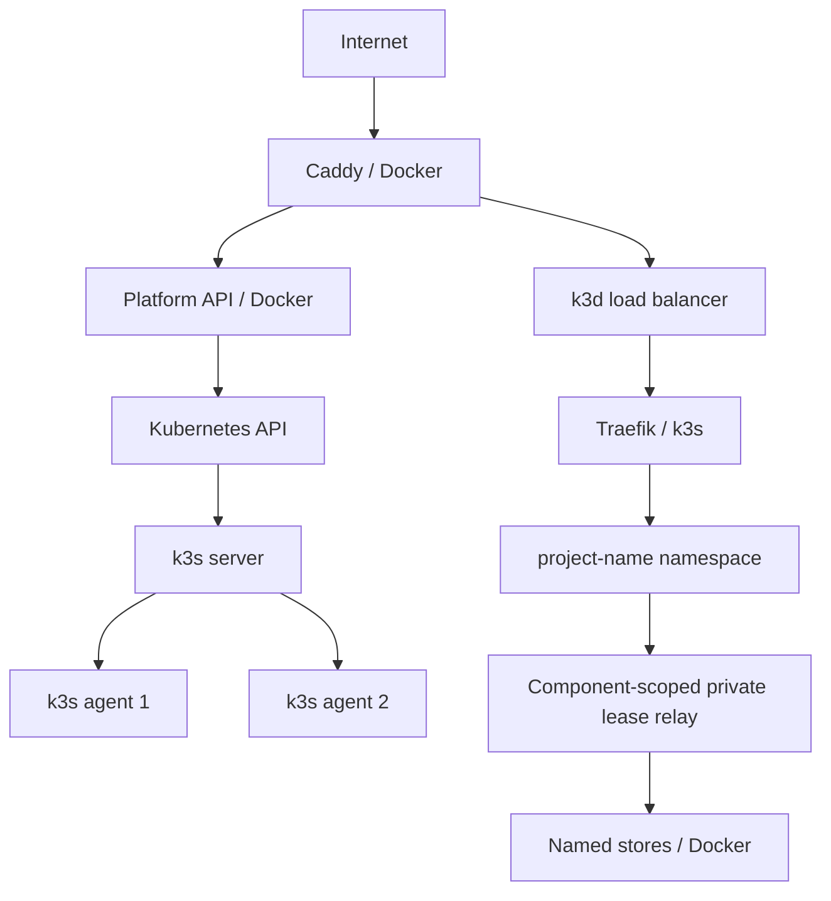
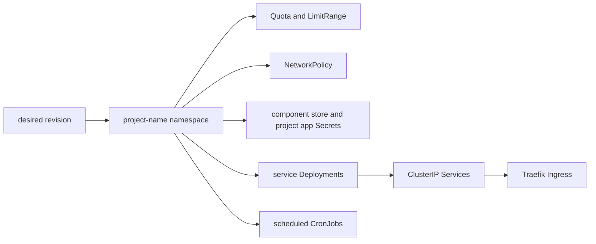
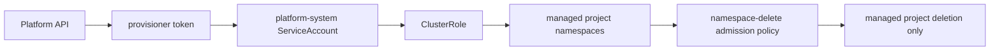

# Platform infrastructure

Status: implemented single-host k3d/k3s workload plane. This page documents repository configuration, not production or hostile-tenant isolation acceptance.

## Role and topology

Kubernetes runs developer workloads. Caddy, the Platform API, PostgreSQL, Keycloak, and monitoring run as Docker Compose services on the same Ubuntu host. `scripts/internal/cluster_config.py` configures k3d with one k3s server, two agents, and a load balancer. The load balancer publishes HTTP only on `127.0.0.1:8081`; Caddy is the public edge.

`scripts/up.sh` renders the k3d configuration, creates or starts cluster `workloads`, writes `.runtime/admin.kubeconfig`, applies the controller and metrics manifests, and refreshes the load balancer after Compose networking is ready. The server enables secrets encryption and has a TLS SAN for its Docker-network name.

Bootstrap also records `PLATFORM_METRICS_PROXY_CIDRS` in `.env` from the control-plane
Node's PodCIDR. In the pinned k3s/flannel setup, a service-proxy request to a worker
Pod uses the control-plane flannel address (the PodCIDR's network address). Metrics
opt-in adds an ingress policy for that single `/32` or `/128` source and the
declared metrics port. It does not allow the whole node or Pod network. Bootstrap
refreshes the addresses on deployment; reapply metrics-enabled applications after
a control-plane PodCIDR change.

## Runtime inventory

| Component | Default operator endpoint | State and responsibility |
|---|---|---|
| Caddy | `127.0.0.1:80/443` locally; configured edge address remotely | TLS, Platform API route, and workload edge route; certificate data is in its Compose volume |
| Platform API | `127.0.0.1:8000` | Public platform contract, durable operations, authorization, audit, and provider execution |
| Keycloak | `identity.localhost` locally or `IDENTITY_DOMAIN` remotely | Reference OIDC identities and clients; state is in the Keycloak PostgreSQL database |
| PostgreSQL | Docker network only | Platform catalog, audit, and named-resource databases in persistent Compose storage |
| k3d load balancer | `127.0.0.1:8081` behind Caddy | Routes workload HTTP to Traefik and project Services |
| Prometheus | `127.0.0.1:9090` | Metrics, rules, and generated discovery targets |
| Grafana | `127.0.0.1:3000` | Dashboards; administrator password comes from `.env` |
| Alloy and Loki | Internal Compose endpoints | Docker and minimized workload-envelope collection and retained log storage |
| Tempo and telemetry gateway | Internal Compose endpoints | Authenticated opt-in traces, bounded storage and project-filtered reads |
| Store relay and consoles | Internal isolated networks | Scoped native access and human browser consoles; optional providers require selection and budgets |
| Alertmanager | Internal Compose endpoint | Alert grouping and configured receivers |

The private `.env` is the installation's secret/configuration input and must be
backed up securely. `.runtime/admin.kubeconfig` is the local cluster administrator
credential. Neither belongs in Git or incident attachments. Optional backup,
heartbeat, and watchdog state is documented under
[Operational components](components/README.md).

## Project resources

Each project receives `project-<name>`. The Platform API reconciles Namespace, ResourceQuota, LimitRange, NetworkPolicy, approved binding Secrets, workload Deployment(s), Service(s), and public Ingress where applicable. Component applications create one Deployment per long-running service and one CronJob per scheduled component. CronJobs use `Forbid` concurrency and bounded job history.

Workload pods run non-root as UID/GID 10001, have read-only root filesystems, drop capabilities, use RuntimeDefault seccomp, mount writable `/tmp`, and do not automatically mount Kubernetes API tokens. Tracing opt-in adds only
a short-lived Pod-bound telemetry-audience token, not the provisioner credential. These controls reduce accidental privilege; they do not provide hostile-tenant isolation on the shared host.

## Provisioner authority

The Docker-hosted Platform API is trusted infrastructure. Its `platform-system/provisioner` ServiceAccount has the cluster-level rights necessary to reconcile project resources, inspect pod logs, and read pod metrics. Kubernetes users do not receive this credential. A ValidatingAdmissionPolicy limits the provisioner's namespace deletion to labelled, managed `project-*` namespaces.

The ServiceAccount token is a sensitive, long-lived infrastructure credential. Rotate it by deleting `provisioner-token`, rerunning bootstrap, and restarting the API.

## Networking

Public ingress reaches the hosted-access authorizer through Traefik; protected
backends accept only authorizer traffic. Private services retain same-namespace
connectivity. NetworkPolicies allow DNS and explicitly bound component access to
private relay lease ports; unbound components receive no project-wide PostgreSQL
exception. Other egress requires an approved declaration and is denied after
policy convergence. New pods can briefly have egress before kube-router rules apply. Compose DNS does not resolve from pods, so PostgreSQL uses a fixed private IP. PostgreSQL TLS is not configured. [ADR-020](../architecture/decisions/ADR-020-generic-hosted-application-integration.md) accepts that transport as outside the first-release cross-project encrypted-channel requirement; operators must not describe the profile as encrypting all application traffic.

## Metrics and capacity

`kube-state-metrics` runs in `platform-system` with list/watch access to nodes, namespaces, pods, and workload controllers. Prometheus reaches it through NodePort 30090 on the k3d server. The Platform API combines Node allocatable values and active Pod requests with a fresh host resource snapshot for admission. Physical host CPU is counted once; node memory is bounded by Docker container limits. The audited `/operator/capacity` view exposes host and Kubernetes budgets, limiting constraints, and observed node metrics, with explicit unavailable states. Admission is opt-in and its budgets are managed by the deployment inventory; see the [capacity accounting procedure](runbooks/platform.md#capacity-accounting).

The `host-capacity` collector is trusted operator infrastructure with Docker socket
authority. It has no network, uses only GET requests, and writes resource allocations
to a shared volume every 15 seconds. The API mounts that volume read-only and does
not receive the Docker socket. Container environment values and credentials are
excluded from the snapshot. Missing/stale snapshots block enabled admission.

The light-load profile caps shared services at 10.875 GiB RAM and 7.5 CPU cores
with all optional shared providers enabled and no dedicated Neo4j instances.
Monitoring services without CPU caps additionally share the configured host CPU
overhead allowance. Kubernetes defaults to a 2 GiB server and two 7 GiB workers
(16 GiB total). These ceilings are sized for the observed small datasets and low
traffic; re-measure before increasing concurrency, ingestion or database sizes.
The host/runtime overhead allowances and minimum reserve are unchanged.

## Persistence and failure domain

Kubernetes objects are disposable desired-state projections. Platform catalog, grants, audit records, named-resource databases, and identity data live in external PostgreSQL volumes. Recreating k3d requires catalog replay and is not a database restore.

All local components share one host failure domain: Docker, k3d, edge, PostgreSQL, and local monitoring can fail together. The external watchdog is the independent host-outage signal. Use the Ansible acceptance playbooks for disposable live drills.

## Current limits

- No high availability or multi-host control plane.
- No hostile-tenant isolation claim.
- Kubernetes API, Docker socket, PostgreSQL, and monitoring backends are not public interfaces.
- Aggregate admission combines Kubernetes requests, shared-container limits, and explicit host/runtime allowances. It does not guarantee per-node fit, storage capacity, or peak-load headroom; calibrating allowances and checking capacity alerts remain operational work.
- Pod-log retention is kubelet best effort, not a platform retention guarantee.
