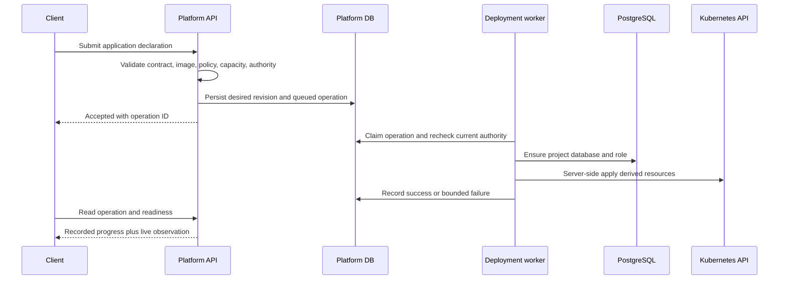

# Deployment and Kubernetes

The application contract describes workload intent, not a Kubernetes manifest.
The current component form supports container services and scheduled jobs in a
single default environment. A service may be private or public; a scheduled
component runs as a CronJob. The API validates names, ports, resource bounds,
replicas, schedules, and outbound destinations. It resolves image references
and checks reserved cluster capacity before recording an accepted deployment.
The API rejects capabilities it cannot safely implement.

## From declaration to workload

The worker uses a durable operation record rather than relying on the original
HTTP connection. It checks that its revision is still the desired one and that
the actor retains deployment authority. Its steps are repeatable enough to
resume after interruption. Provider errors leave a failed operation with a
safe error code and step, rather than exposing arbitrary provider messages.
Readiness is observed after the Kubernetes apply; an accepted or even applied
revision does not imply that every pod is ready.

## What Kubernetes receives

The platform derives a `project-<name>` namespace with a ResourceQuota,
LimitRange, and NetworkPolicies. Services become Deployments and Services;
scheduled components become CronJobs. Public HTTP hosts have Ingress objects,
but component-form public backends are routed through the hosted-access
authorizer rather than exposed directly. The project namespace's access policy
allows that authorizer to reach the protected backend while restricting other
paths. An application can call a private same-namespace Service by its stable
service name. External egress requires an allowed destination and an explicit
network rule.

Workload pods run without an automatically mounted Kubernetes service-account
token. Their generated security context requires a non-root user, dropped
capabilities, no privilege escalation, a read-only root filesystem, and a small
writable temporary volume. CPU and memory requests/limits, startup, readiness,
and liveness probes are derived from the supported declaration. These
constraints are part of what it means to deploy through this platform rather
than directly to the cluster.

The worker also ensures a separate PostgreSQL database and role for the
project. Database connection values reach pods through a Kubernetes Secret.
Ordinary configuration is part of desired application state and can create a
new rollout revision. Write-only application secrets and managed service
credentials live in Kubernetes Secrets; their values are absent from desired
revisions and API reads. Secret changes mark pod templates so workloads adopt
the new version. A previous secret value can be held temporarily for an
explicit rotation confirmation or revert.

## Change and retirement

Restart creates a durable operation for the current desired application;
rollback reads a retained specification and creates a new desired revision.
Drift reads the live Deployment or CronJob and compares selected fields with
the desired revision, reporting differences without silently changing them.
Retirement removes the project runtime while retaining its catalog identity
and data by default. Permanently purging a retired project's retained scope is
a separate operator action. These distinct transitions avoid treating a failed
rollout, a restart, retirement, and deletion of data as the same event.
