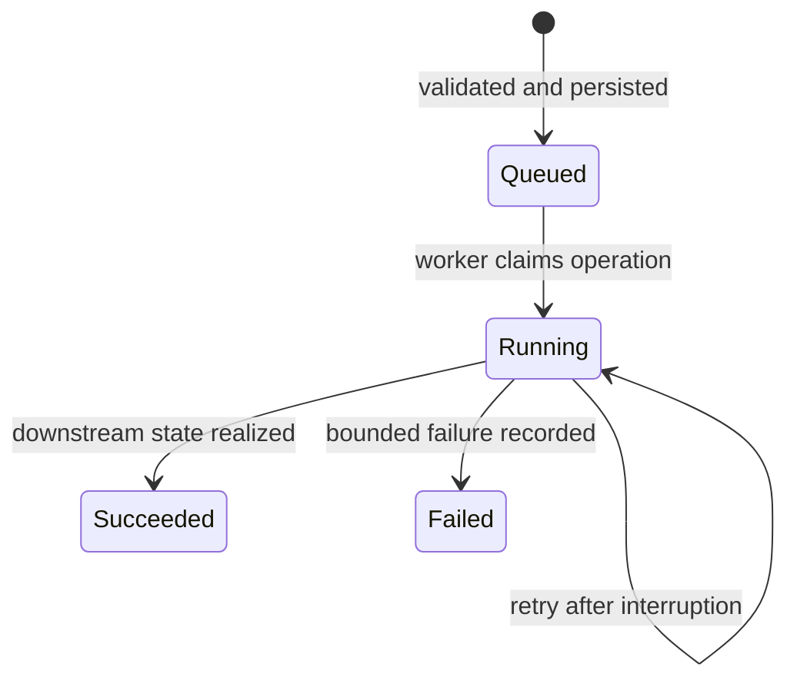

# Design concepts

## Declare intent, then derive implementation

An application declaration names a supported capability—such as a container
service, a schedule, resources, a public HTTP endpoint, or an outbound
destination. It does not submit arbitrary Kubernetes manifests. The API checks
the declaration against its supported contract, resolves image references, and
derives the Kubernetes objects. This keeps project identity and policy stable
when the runtime implementation changes. Unsupported fields are rejected rather
than silently passed through to the cluster.

The project catalog retains both a current desired specification and immutable
application revisions. A later revision expresses a new desired state; it does
not rewrite the previous declaration. Rollback creates a new change based on a
retained revision. Configuration is versioned with the application, while secret
values have a separate write-only path.

## Accept changes durably, realize them asynchronously

An accepted deployment or hosted-access change may require database work,
Keycloak changes, Kubernetes updates, and readiness checks. The API first
persists an operation and returns its identity. A worker then processes that
operation, records success or a bounded failure code, and can resume work after
interruption. This makes an HTTP `202` an acknowledgement of recorded intent,
not a claim that the workload or access grant is already usable.

The deployment and hosted-access domains have separate operation records and
workers because their downstream effects differ. Deployment operations apply
application resources. Hosted-access operations reconcile policy, Keycloak
clients and roles, access-boundary state, and managed service credentials.

## Make concurrent changes explicit

Revisions and resource versions make a change's starting point visible.
Deployment updates may use an expected revision. Hosted-access resources use
quoted ETags for conditional changes; a stale version fails instead of replacing
someone else's newer decision. Idempotency keys on creates let a repeated
request refer to the same accepted intent when a client did not receive the
first response. These controls prevent ambiguous retries from multiplying
resources or silently losing updates.

## Keep authority at the receiving boundary

The platform validates a token and checks current grants on API requests.
Workers recheck relevant authority before carrying out durable work. Keycloak
claims establish identity but do not replace the platform's project grants.
For hosted application traffic, the gateway intersects token claims with active
platform memberships. A stale token alone cannot recreate a revoked grant.
Protected application backends also have network rules that limit the path to
the shared authorizer.

Failures in identity, audit, policy snapshots, or capacity observation do not
become implicit permission to proceed. For example, an unavailable capacity
assessment rejects a deployment instead of guessing that room exists; an
expired access snapshot stops protected traffic instead of continuing with an
unbounded old policy. These choices favor a visible failure over an unsafe or
unverifiable success.

## Separate stored intent from observed runtime state

The platform DB owns project and authorization intent. Kubernetes owns the live
workload objects and Secret values. Keycloak owns identities and issued tokens.
Project databases own application data. Observations can be read through the
API, but copying them into the platform catalog would make that catalog a
misleading substitute for the actual runtime. Drift detection reports a
difference between desired and observed state; it does not silently repair it.
