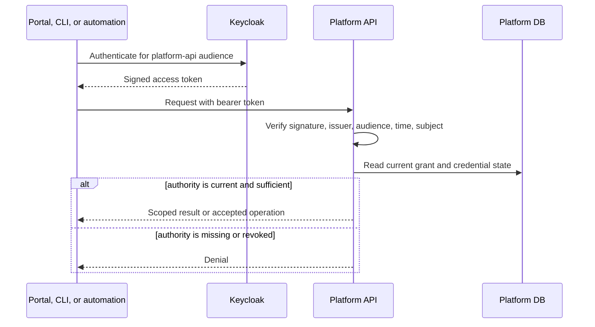
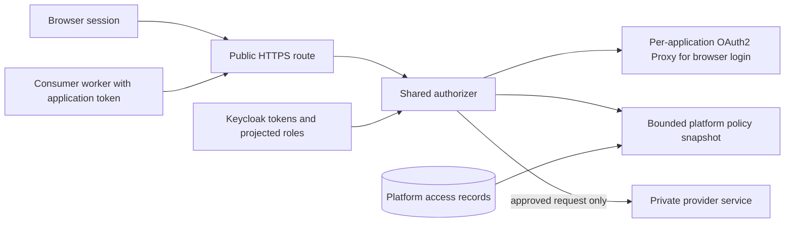

# Identity and authorization

The platform uses Keycloak as its reference OpenID Connect provider. Keycloak
establishes an identity and issues signed tokens; the platform decides the
identity's authority. This division applies twice: when someone administers a
project through the Platform API, and when someone calls a hosted application's
public service. These are distinct audiences and authorization decisions.

## Administration of the platform

The portal and CLI are public OIDC clients in the `platform` realm. Human login
uses flows with PKCE; the CLI also supports device authorization. Automation
uses confidential clients and short-lived client-credentials tokens. The API
checks a bearer token's signature, issuer, audience, expiry, and subject, then
uses the pair `(issuer, subject)` as the principal key. It does not grant a
project role merely because a token contains a role-like claim.

The platform database holds the current grants. `viewer` permits project
inspection; `developer` adds application change and deployment; `project-admin`
adds project grants and retirement; `platform-admin` is platform-wide. A
project-scoped deployment credential is further limited to its project and to
view/deploy actions even if its provider token remains valid. Revocation and
expiry are checked against the credential record on requests. An invalid or
missing token fails authentication; a valid principal without the required
current authority fails authorization.

## Access to hosted applications

A public service has an explicit route policy. A policy names canonical paths
and methods, selects either `browser-session` or `bearer-token` authentication
for each route, and requires one or more application groups. Unmatched or
ambiguous routes do not gain implicit access. Governance controls whether
optional identity attributes such as email may be released.

For a browser route, a per-application OAuth2 Proxy handles the Keycloak login
exchange and secure cookie. The shared authorizer still makes the route and
group decision. On a person's first login, the platform can record a pending
access request; pending is not a grant. A provider project administrator assigns
groups before the membership becomes active.

For a bearer-token route, a consumer project requests access to a provider
application. The provider project administrator approves the request and assigns
allowed groups. This rule also applies when consumer and provider are the same
project. The access worker then creates a confidential Keycloak service client,
projects its group roles, and puts the client ID, secret, and token URL into
managed Kubernetes Secrets in the consumer namespace. The credential identifies
the consumer **project client**, not one particular worker component. A worker
obtains a short-lived token for the provider application audience and sends it
to the public HTTPS route.

The authorizer checks the token or browser session against the matched route,
then intersects token group claims with **active** platform memberships. Service
tokens must also correspond to an active approved service request and a live
credential generation. The authorizer strips untrusted identity headers and
forwards its own verified principal and group identifiers. Kubernetes
NetworkPolicy limits the public backend so traffic is expected to arrive through
that authorizer, including from a worker in the same project.

Policy snapshots have a bounded lifetime of at most five minutes. If the
authorizer cannot refresh an expired snapshot or cannot compile it, protected
traffic fails closed. Access operations coordinate Keycloak projection and
authorizer acknowledgement before a policy or service grant is considered
active. Revocation can deny from platform state even while an older signed
token is still within its token lifetime.
