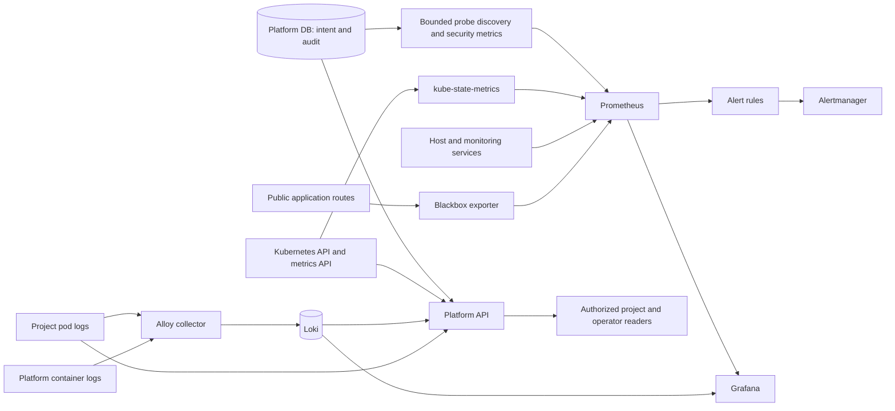

# Observability model

The platform observes three different things: **recorded intent** in the
platform database, **runtime state** in Kubernetes, and **externally visible
behavior** at an application route. They can disagree during a rollout or an
incident. An accepted deployment operation establishes that a change was
recorded; it does not establish that pods are ready or that a caller can reach
the route. Observation reports these differences without changing the desired
state.

## Live observation through the Platform API

The API combines catalog context with live provider reads. Project-scoped
observation endpoints require the current `view` permission; the operator
capacity view requires platform administration. The main views answer different
questions:

| View | Evidence and meaning |
| --- | --- |
| Operation status | Durable progress or failure of requested work. This is execution state, not proof of application health. |
| Readiness and components | Kubernetes Deployment and pod readiness for services; CronJob and Job status for scheduled components. A provider error is reported as unknown rather than ready. |
| Drift | Comparison of a desired revision with live Deployment or CronJob fields. A difference is reported, not repaired by the read. An observation failure can make the result unknown. |
| Resources and usage | Namespace topology and declared resource allocations from Kubernetes; current pod CPU and memory from the Kubernetes metrics API. Usage distinguishes fresh, stale, missing, and unavailable samples. |
| Logs | Bounded recent pod-log reads or minimized retained operational events, both scoped to the authorized project. |

These views are snapshots, with timestamps or explicit state where appropriate.
An inventory route is a declared endpoint, for example, but does not prove
that the external certificate or the application is working. The API does not
turn a missing metrics sample or a failed Kubernetes read into an empty,
healthy result.

## Metrics, probes, and alerts

The platform catalog publishes a disposable discovery file for Prometheus.
Public services in a component-based application become blackbox targets; the
legacy single-service application also has a probe target. Target definitions
use bounded readiness paths and probe profiles, rather than arbitrary probe
URLs or credentials supplied by an application. Prometheus scrapes the
blackbox exporter for route behavior, kube-state-metrics for Kubernetes object
state, node-exporter for host state, and the monitoring services themselves.
Grafana has Prometheus and Loki as data sources.

The planned Phase 4 [application metrics capability](../architecture/application-contract.md#planned-application-metrics-capability-phase-4)
adds opt-in, private Prometheus-format scrapes for declared service components
and bounded project-scoped metric reads. Current application discovery supplies
blackbox availability targets only; it does not collect framework metrics.

For a protected public component, the probe tests the **access boundary**:
an unauthenticated request should receive an expected redirect or denial. It
does not authenticate as an application user and does not prove that the
backend can serve authorized traffic. Kubernetes readiness and the public
probe are therefore separate signals. The alert rules cover unavailable pods
or deployments, failed or missing route probes, stale discovery, host disk
pressure, scrape failures, and selected security events.

Discovery and security metrics are regenerated from durable records. If a
source query fails, the publisher retains the last successful file; a
freshness metric and alert distinguish that stale view from a current one.
Prometheus stores a bounded time series history (configured for seven days or
4 GB, whichever limit is reached first). Alertmanager receives rule results.
In the repository's default configuration its receiver is local only, so an
alert is not automatically delivered to an external notification channel.

## Logs and security evidence

Recent project logs come directly from the Kubernetes pod log API. The API
limits pods, bytes, lines, and time range, supports component and instance
selection, and applies best-effort redaction. Kubelet log availability is best
effort, especially after an instance disappears. A pod-log response can state
that no pods or no output were found, or that the log API is unavailable.

Alloy also collects project pod logs through a dedicated read-only Kubernetes
credential. Before forwarding them to Loki, it keeps only a small structured
operational envelope: an allowed event name, level, and optional correlation
ID. Unrecognized fields and ordinary free-text workload logs do not enter
this retained project stream. Alloy separately forwards platform Docker
container logs to Loki. Loki is configured for seven-day retention. The
Platform API's retained-log view constructs a fixed project selector, checks
returned stream labels and event format again, and bounds the query. It does
not accept caller-supplied LogQL or expose central storage as a project-wide
query interface. Retention is a configured window, not a promise that every
event was ingested.

Audit records serve a different purpose from logs. `platform_audit.events` in
the platform database is the restricted, durable evidence of platform actions,
their outcomes, and the actor when identifiable. A background reader turns recent
authentication failures, access denials, and privileged membership changes
into bounded, non-secret Prometheus series for alerting; the full audit event
remains in the database. The audit trail is not replaced by a dashboard or by
the shorter-lived metrics and log stores.

The resulting model keeps evidence in its proper scope: the database records
decisions and operations, Kubernetes reports workload state, probes report
route behavior, and telemetry provides history and warning signals. None of
those signals alone certifies that a deployment or access change has completed
end to end.
