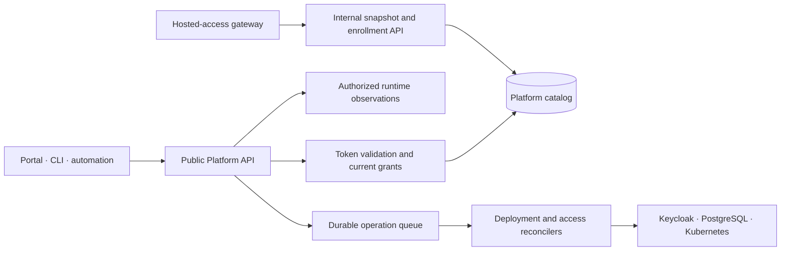

# The Platform API

The Platform API is the authority boundary between clients and platform
infrastructure. Its public HTTP interface is shared by the portal, CLI, and
automation. Clients describe a domain change and receive a domain result; they
do not choose Kubernetes objects, Keycloak administrator calls, or SQL writes.
The API validates each request, identifies its caller, checks the current
project or platform grant, and records auditable outcomes.

## What the API controls

| Domain | API responsibility | State or provider involved |
| --- | --- | --- |
| Project identity and discovery | Create and list projects; report supported capabilities | Platform catalog and project grants |
| Application declaration | Validate a flat or versioned `Application` body, resolve images, assess capacity, record revisions and deployment operations | Platform DB, then Kubernetes with approved component store bindings |
| Lifecycle | Restart, rollback, retire, and operator-controlled purge with recorded operation or scope | Platform DB and runtime resources |
| Configuration and secrets | Replace ordinary configuration as desired state; write, rotate, confirm, or revert secret values through a separate path | Revisions for configuration; Kubernetes Secrets for values |
| Observation | Report operation status, readiness, components, resources, usage, drift, and bounded logs | Catalog plus live Kubernetes and observability queries |
| Project authority | Manage project grants and automation-credential metadata | Platform DB, with credential clients projected to Keycloak |
| Hosted application access | Manage groups, route policies, governance, human requests, memberships, service requests, and access operations | Platform DB, Keycloak, and the hosted-access boundary |
| Named stores | Independent resources, explicit human grants/component bindings, expiring leases, consoles, retirement, quota and verified-intent purge | Platform DB, provider adapters and private relay |
| AI assistance | Classified, authorized evidence reads, bounded runs, history and reviewed rollback proposals | Durable AI records, configured model and deployment operations |
| Operator authority | Inspect capacity, audit, recovery requests, retirement and purge scope, and platform grants | Restricted platform-wide state and providers |

The URL layout reflects these domains rather than one uniform prefix. Core
project operations include paths such as `/projects/{name}`; deployment status
uses `/v1/operations/{id}`; hosted-access resources use
`/v1/projects/{project}/...`; and privileged functions use `/operator/...` or
`/platform/...`. The capability response describes what the current deployment
supports. The versioned application envelope is a contract for desired
application behavior, not a direct Kubernetes API.

## Acceptance, execution, and observation

For a deployment, the API validates and persists a new desired revision and an
operation in one controlled transaction, then returns the operation ID and
status URL. A worker later resolves approved bindings and applies derived Kubernetes
objects. Independent named-store reconciliation provisions provider resources,
rotates credentials and observes access cleanup. The operation tracks whether that execution succeeded or
failed. A client can separately inspect readiness, which is an observation of
the running workload. The same distinction holds for access changes: approving
a service request records an authorization decision, while a separate access
operation projects credentials and policy into the providers before access is
active.

The API therefore reports several kinds of truth: **desired** specifications
and approvals from PostgreSQL, **operation** progress from durable records, and
**observed** behavior from the runtime. It does not collapse them into one
success flag. Conflicts from stale revisions or ETags are returned to the
caller; the server does not overwrite a concurrent change to make a request
appear successful.

The hosted-access gateway uses a separate internal API for bounded policy
snapshots, replica acknowledgements, and first-login enrollment. These routes
are not general project administration methods. Internal authorization and the
gateway's network placement keep that communication distinct from public
client calls.
