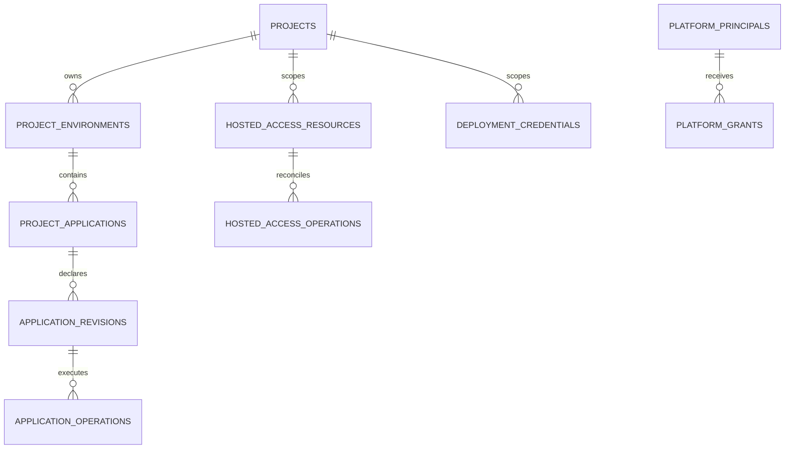

# What the platform database stores

The PostgreSQL database named `platform` is the platform's durable record of
project identity, desired application state, authorization decisions, and work
to be reconciled. It is not the database that an application uses for its own
business data. Each provisioned project has a separate `project_<name>`
PostgreSQL database and role for that purpose.

The diagram groups records by meaning. It shows conceptual relationships;
not every line represents a database foreign-key constraint.

| Record family | What it means |
| --- | --- |
| `projects`, `project_environments`, `project_applications` | Stable catalog identities and the currently supported default environment/application relationship. `projects` also holds current status and a current desired specification. |
| `application_revisions` | Immutable numbered desired specifications. They let an update, comparison, or rollback refer to a precise declaration. |
| `application_operations` | Durable deployment and restart work: target revision, original actor, state, attempts, bounded result, and error code. A worker can find queued or interrupted work after restart. |
| `project_retirements`, `data_service_recovery_requests` | Retained retirement inventory and requests for operator-assisted data-service recovery. |
| `platform_principals`, `platform_grants`, `platform_authorization_metadata` | The issuer/subject identities seen by the API, their project or platform roles, and authorization metadata. |
| `deployment_credentials` | Automation-client identity and lifecycle metadata: provider client identifiers, project and kind, expiry, rotation lineage, use, and revocation state. It does not contain the client secret. |
| `hosted_access_resources`, `hosted_access_principals` | Versioned groups, policies and policy revisions, governance, human requests, memberships, service requests, and stable hosted principal mappings. Service records hold credential identifiers and states, not credential values. |
| `hosted_access_operations`, `hosted_access_idempotency`, `hosted_access_metadata`, `hosted_access_replicas` | Pending access reconciliation, replay protection, policy generation, and authorizer replica acknowledgements. |
| `platform_audit.events` | Append-only, restricted audit records identifying actor, action, scope, result, revision or operation, and redacted detail. |

This separation matters during partial failure. A project's desired revision can
be present while its Kubernetes rollout is still pending. An approved service
request can be present while Keycloak provisioning has failed. The operation
record makes each unfinished step visible and recoverable without pretending
the downstream resource already exists.

## State held elsewhere

The platform database does **not** hold application rows. Those live in each
project's separate PostgreSQL database. It does not hold write-only application
secret values, service client secrets, or database passwords. Application and
managed service credentials are placed in Kubernetes Secrets in the relevant
namespace; Keycloak holds its client identities, and the platform derives some
provider secrets from a protected runtime key. The project database password
is likewise derived from a runtime key rather than stored as a platform row.

Keycloak stores realm accounts, client configuration, and projected client
roles, but the platform DB remains authoritative for platform grants and
hosted-access decisions. Kubernetes stores the actual workload objects and
Secret values. Current pod state, metrics, and log streams are observed through
their runtime systems; the catalog does not treat a copied observation as
authoritative. This is also why a backup of only the `platform` database would
not by itself contain all application data or runtime secrets.
