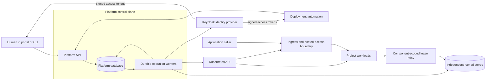

# System model

The platform gives a project a controlled way to declare an application and
manage its lifecycle. A project is the principal unit of ownership: it has a
stable catalog identity, grants, a default environment, application revisions,
a Kubernetes namespace when deployed, and independently managed named data resources.
Only approved component bindings supply store credentials; unbound applications
receive no automatic database.
The currently supported application declaration can describe container services
and scheduled components. An exposed service also has an explicit access policy;
being reachable on the public network does not itself grant callers access.

The Platform API is the control-plane boundary. The portal, CLI, and automation
clients all call it. It checks identity and authority, validates intent, records
durable state, and returns safe status. Background workers in the platform API
service carry out accepted changes. Applications do not receive direct authority
over the platform catalog, Keycloak administration, or Kubernetes administration.
In the reference deployment, the API and shared services run outside project
namespaces; the API reaches the Kubernetes API with a restricted controller
configuration. Project workloads run inside their own Kubernetes namespaces.

There are two kinds of traffic in this picture. **Control traffic** changes or
inspects project intent through the Platform API. **Application traffic** reaches
a running service through Ingress and, for a protected public component, the
hosted-access boundary. The latter checks a route policy and caller identity
before forwarding to the private application backend. Its decision is based on
platform-owned access state, not on a permission supplied by the application.

Keycloak answers *who is this caller?* It issues OIDC tokens for people and
machine clients. The platform answers *what may this caller do here?* It owns
project grants and hosted-application approvals in its database. Kubernetes
answers *what is running?* It schedules pods and holds runtime objects such as
Deployments, Services, NetworkPolicies, and Secrets. The platform database
answers *what was requested, approved, and queued?* These responsibilities are
related but deliberately distinct.

The platform also observes the runtime. Readiness, component state, inventory,
usage, drift, and bounded logs are exposed through authorized API reads. A
recorded desired revision can therefore coexist temporarily with an older
running revision, a failed rollout, or an unavailable observation. That is why
the API exposes operation state separately from the initial acceptance response.
The [observability model](observability.md) explains how those reads relate to
probes, metrics, retained logs, alerts, and audit evidence.
